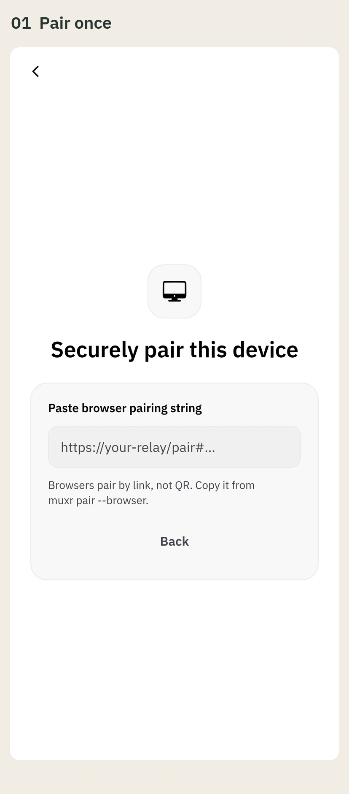
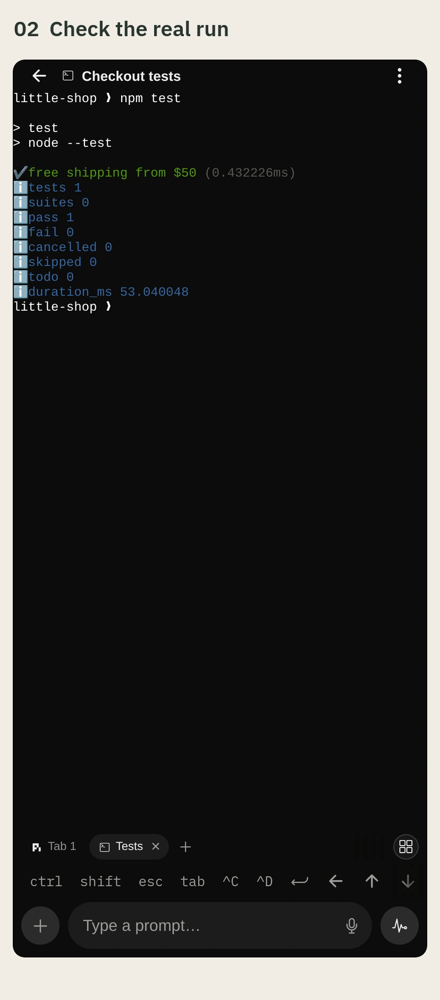
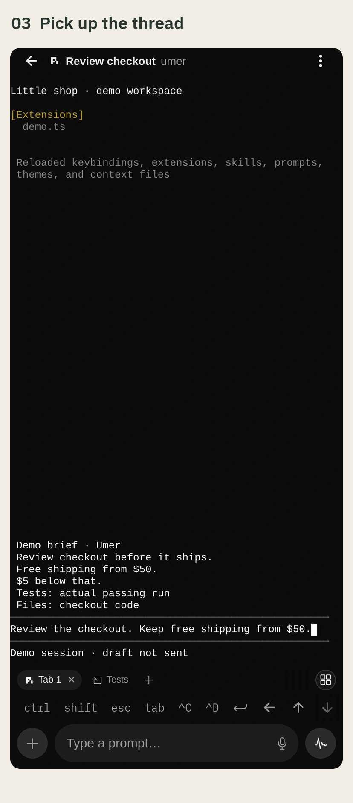
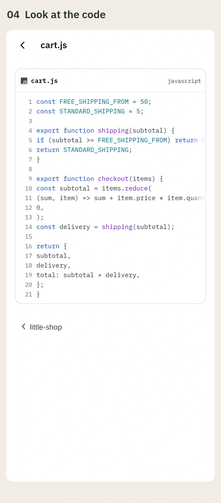

<h1 align="center">
  <a href="https://trymuxr.com"></a><br />
  muxr
</h1>

<p align="center">
  <strong>When an agent needs you, answer from your phone.</strong><br />
  muxr shows which agent is waiting and what it asks. One tap answers it in the same live terminal.
</p>

<p align="center">
  <picture>
    <source media="(max-width: 520px) and (prefers-color-scheme: dark)" srcset="docs/readme/hero-phone-night.webp" />
    <source media="(max-width: 520px)" srcset="docs/readme/hero-phone-day.webp" />
    <source media="(prefers-color-scheme: dark)" srcset="docs/readme/hero-night.webp" />
    <source media="(prefers-color-scheme: light)" srcset="docs/readme/hero-day.webp" />
    
  </picture>
  <br />
  <sub>The real app and a real agent run, in a demo shop.</sub>
</p>

<p align="center">
  <a href="https://trymuxr.com/downloads/stable/android"><strong>Get it for Android</strong></a> ·
  <a href="https://testflight.apple.com/join/aJSbs8pN"><strong>Join iOS TestFlight</strong></a> ·
  <a href="#get-going"><strong>Get going ↓</strong></a>
</p>

<p align="center">
  <a href="https://www.npmjs.com/package/@trymuxr/cli"></a>
  <a href="https://github.com/umeranjum17/muxr/actions/workflows/ci.yml"></a>
  <a href="LICENSE"></a>
</p>

## A little less waiting at your desk

An agent can work for a while, then need one answer to keep going. muxr brings that moment to your phone: see who needs you, open the **same live terminal**, and answer with one tap or a follow-up, without starting over.

<p align="center">
  <picture>
    <source media="(prefers-color-scheme: dark)" srcset="docs/readme/answer-night.webp" />
    <source media="(prefers-color-scheme: light)" srcset="docs/readme/answer-day.webp" />
    
  </picture><br />
  <sub>A real recording. The quiet waits are shortened.</sub>
</p>

Your agents, code, sign-ins and model subscriptions stay on your computers. Terminal traffic, prompts and files are end-to-end encrypted.

## A few taps from start to shipped

<p align="center">
  <a href="docs/readme/pair-day.webp"><picture><source media="(prefers-color-scheme: dark)" srcset="docs/readme/pair-night.webp" /></picture></a>
  <a href="docs/readme/terminal-day.webp"><picture><source media="(prefers-color-scheme: dark)" srcset="docs/readme/terminal-night.webp" /></picture></a>
</p>
<p align="center">
  <a href="docs/readme/agent-day.webp"><picture><source media="(prefers-color-scheme: dark)" srcset="docs/readme/agent-night.webp" /></picture></a>
  <a href="docs/readme/files-day.webp"><picture><source media="(prefers-color-scheme: dark)" srcset="docs/readme/files-night.webp" /></picture></a>
</p>

<sub>Fresh web-app captures with seed data. Tap a screenshot to look closer; the native apps have their own terminal renderer.</sub>

## Get going

### 1. Set up your computer

You need **Node.js 22 or newer**, Linux, macOS or WSL, and a coding-agent CLI installed and signed in on that computer.

Run in an interactive terminal:

```bash
npm install -g --ignore-scripts @trymuxr/cli@latest
muxr
```

**Trying the newest test build?** Its phone app and computer side must be the same version. Download the computer package from the [muxr 0.2.5 test release](https://github.com/umeranjum17/muxr/releases/tag/v0.2.5-nightly.27.1), then install that file:

```bash
curl -LO https://github.com/umeranjum17/muxr/releases/download/v0.2.5-nightly.27.1/trymuxr-cli-0.2.5-nightly.27.1.tgz
npm install -g --ignore-scripts ./trymuxr-cli-0.2.5-nightly.27.1.tgz
muxr
```

muxr opens guided setup on a new computer and installs [Herdr](https://herdr.dev) if needed. Choose how your phone reaches it—including a route that works away from home—with the short plan shown under the routes; Enter applies it.

**Prefer a desktop app?** On Linux the same setup runs in one window: it starts the host, installs Herdr if it is missing, starts at login, can keep the computer awake, and pairs with your phone by QR or by two words. Build the AppImage with `yarn desktop:build:linux`, then run `apps/desktop/release/muxr-*.AppImage`. A computer without FUSE 2 runs it only as `./apps/desktop/release/muxr-*.AppImage --appimage-extract-and-run`, which has to be passed on every launch, so start at login needs FUSE 2; the [download page](https://trymuxr.com/desktop) names the package to install. From the phone app, **Add your computer** sends a link and QR to the desktop download (Linux for now; the signed Mac build follows).

### 2. Get the phone app

[Android APK](https://trymuxr.com/downloads/stable/android) · [Google Play testing](https://play.google.com/apps/testing/com.trymuxr.app) · [iOS TestFlight](https://testflight.apple.com/join/aJSbs8pN)

Store testing access depends on review and tester availability. [All downloads and checksums →](https://trymuxr.com/downloads)

**Newest test build:** [Android APK 0.2.5](https://github.com/umeranjum17/muxr/releases/download/v0.2.5-nightly.27.1/muxr-0.2.5-389.apk), SHA-256 `1016ad79aaf64cfe70f5f63b6748103c0c8a95f2e5222cb7517223570fb89e46`. Open the file on your phone to install it; Android may first ask you to allow installs from your browser or files app. Pair it with the matching computer package above. Every release, with its APK and checksums, is on the [releases page](https://github.com/umeranjum17/muxr/releases).

### 3. Pair and take a look

In the app, paste the private link or pairing code your computer shows and tap **Connect**, or tap **Scan the QR** where your phone offers it and scan the computer’s one-use QR. Compare the two matching words, then approve on your computer. Home opens with your agents ready to visit. To pair another phone later, run `muxr pair` on your computer for a fresh code.

**Prefer a browser?** Enable browser access during setup, then run `muxr pair --browser` on your computer and open its link. That control link lasts eight hours. You can add the web app to your Home Screen too.

[Step-by-step quickstart →](https://trymuxr.com/docs/quickstart) · [Routes and self-hosting →](docs/SELF-HOSTING.md)

## Small screen. Plenty of room to work.

- **See the whole herd.** Agents grouped by workspace and computer, with live terminal previews and alerts when one needs you or finishes.
- **Keep the real terminal.** Scrollback, sticky modifier keys, reorderable controls, workspace tabs and pane switching. On supported approval prompts, tap a numbered answer.
- **Start something new.** Launch installed agents, shells and worktrees. Send prompt attachments or pick up an existing session.
- **Look before you ship.** Browse files, inspect diffs and download artifacts—with progress and resume after a lost connection.
- **Say it instead.** On-device prompt dictation in the native app, plus native realtime voice. [Voice setup →](docs/VOICE-SETUP.md)
- **Make it feel like yours.** Light and dark themes, terminal text sizes, gestures and notifications. Use Android, iOS or the self-hosted web app.

[What’s new →](https://github.com/umeranjum17/muxr/releases) · [Privacy and trust →](https://trymuxr.com/docs/privacy)

## Build with us

[Contributing](CONTRIBUTING.md) has the local setup and checks. [Architecture](docs/ARCHITECTURE.md) explains how the pieces fit; [releasing](docs/RELEASING.md) covers stable and nightly channels.

[Report a bug](https://github.com/umeranjum17/muxr/issues) · [Website](https://trymuxr.com) · [Self-hosting](docs/SELF-HOSTING.md)

## License

[Apache 2.0](LICENSE). [Third-party notices](NOTICE) · [License inventory](docs/license-inventory.md) · [Name and marks](TRADEMARK.md)
