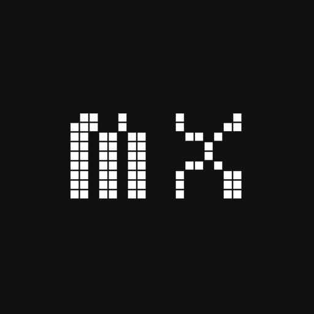
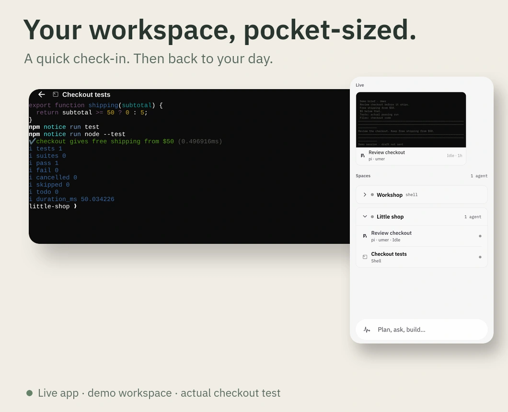
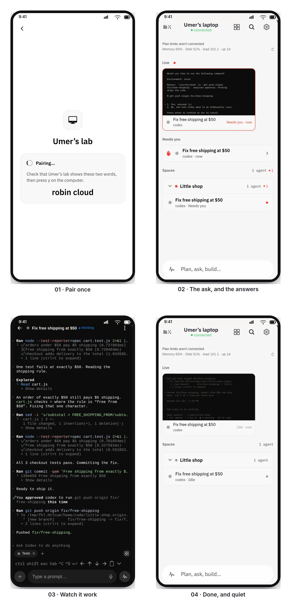
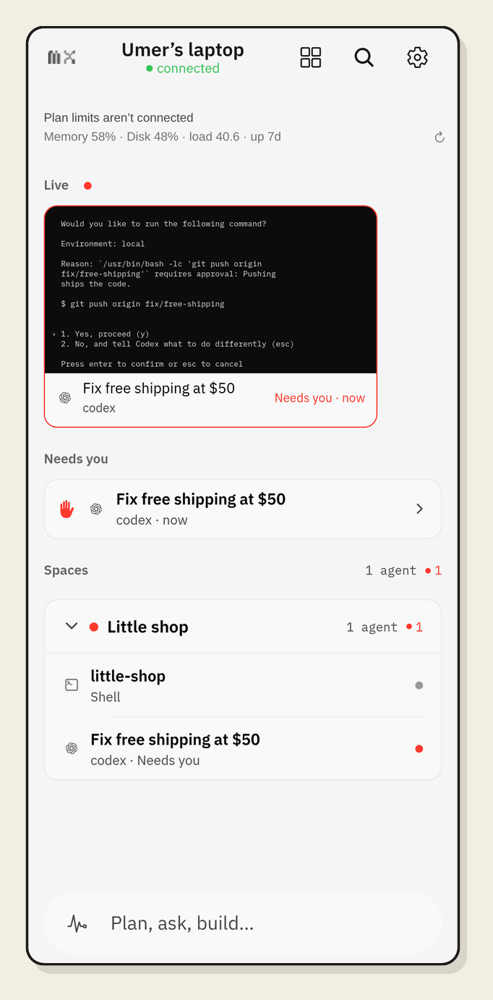

<h1 align="center">
  <a href="https://trymuxr.com"></a><br />
  muxr
</h1>

<p align="center">
  <strong>When an agent needs you, answer from your phone.</strong><br />
  muxr shows which agent is waiting and what it asks, then lets you answer it in the <em>same</em> live terminal. Your code, sign-ins and model subscriptions stay on your computers.
</p>

<p align="center">
  <picture>
    <source media="(max-width: 520px) and (prefers-color-scheme: dark)" srcset="docs/readme/hero-phone-night.webp" />
    <source media="(max-width: 520px)" srcset="docs/readme/hero-phone-day.webp" />
    <source media="(prefers-color-scheme: dark)" srcset="docs/readme/hero-night.webp" />
    <source media="(prefers-color-scheme: light)" srcset="docs/readme/hero-day.webp" />
    
  </picture>
  <br />
  <sub>The real app and a real agent run, in a demo shop.</sub>
</p>

<p align="center">
  <a href="https://trymuxr.com/downloads/stable/android"><strong>Get it for Android</strong></a> ·
  <a href="https://testflight.apple.com/join/aJSbs8pN"><strong>iOS TestFlight</strong></a> ·
  <a href="#three-commands-to-your-first-agent"><strong>Quick start ↓</strong></a> ·
  <a href="https://trymuxr.com/docs"><strong>Docs</strong></a>
</p>

<p align="center">
  <a href="https://www.npmjs.com/package/@trymuxr/cli"></a>
  <a href="https://www.npmjs.com/package/@trymuxr/cli"></a>
  <a href="https://github.com/umeranjum17/muxr/actions/workflows/ci.yml"></a>
  <a href="LICENSE"></a>
  <a href="https://x.com/umership"></a>
</p>

## Three commands to your first agent

```sh
npm i -g --ignore-scripts \
  @trymuxr/cli@latest
muxr
muxr pair
```

Install the app on your phone, scan the computer's QR (or paste the pairing link) and compare the two words. Setup picks how your phone reaches the computer, installs [Herdr](https://herdr.dev) if it is missing, and changes nothing until you press Enter on that plan.

**Nightly builds, the Linux desktop app, browser access, checksums and remote routes: [install options →](docs/INSTALL.md).**

## Why muxr

Answering an agent is not the hard part. Reaching it is.

| How you answer an agent today | With muxr |
| --- | --- |
| Leave the laptop open, check it when you think of it | The ask arrives as a notification |
| A plain terminal over SSH on the phone | The agents and their asks first, one tap to answer |
| A hosted cloud dev box, usually paid by the month | Your own computers, self-hosted, end-to-end encrypted |
| Mirror the whole desktop to the phone | The terminal at your font size, not a video of your monitor |
| Keep up with the agent in a chat app | The same session, with its scrollback and diffs |

muxr is built on [Herdr](https://herdr.dev), the workspace manager for coding agents, and any agent you run in a Herdr pane is visible here.

## What you get

<p align="center">
  <picture>
    <source media="(max-width: 520px) and (prefers-color-scheme: dark)" srcset="docs/readme/steps-phone-dark.webp" />
    <source media="(max-width: 520px)" srcset="docs/readme/steps-phone-light.webp" />
    <source media="(prefers-color-scheme: dark)" srcset="docs/readme/steps-wide-dark.webp" />
    <source media="(prefers-color-scheme: light)" srcset="docs/readme/steps-wide-light.webp" />
    
  </picture><br />
  <sub>Real app, demo checkout task and sample machine vitals.</sub>
</p>

<p align="center">
  <picture>
    <source media="(prefers-color-scheme: dark)" srcset="docs/readme/answer-night.webp" />
    <source media="(prefers-color-scheme: light)" srcset="docs/readme/answer-day.webp" />
    
  </picture><br />
  <sub>A real recording, end to end. The quiet waits are shortened.</sub>
</p>

- **See the whole herd.** Agents grouped by workspace and computer, with live terminal previews and an alert when one needs you or finishes.
- **Keep the real terminal.** Scrollback, sticky modifier keys and workspace tabs; on supported approval prompts, a numbered answer is one tap.
- **Start something new.** Launch installed agents, shells and worktrees, or pick up an existing session and attach a prompt.
- **Look before you ship.** Browse files, read diffs and download artifacts, with progress and resume after a lost connection.
- **Say it instead.** On-device prompt dictation in the native app, plus native realtime voice. [Voice setup →](docs/VOICE-SETUP.md)
- **Watch what it costs.** Usage per provider and tab: token trends, top models and the limits each plan reports.
- **Make it feel like yours.** Light and dark themes, terminal text sizes, gestures and notifications, on Android, iOS or the self-hosted web app.

## Proof, and how to check it

No customer logos to borrow and no quotes to invent, so here is what you can check for yourself:

- **Every build can be checked before you install it.** The [download page](https://trymuxr.com/downloads) publishes each APK with its SHA-256 ([stable](https://trymuxr.com/downloads/stable/checksums) · [nightly](https://trymuxr.com/downloads/nightly/checksums)), and each [release](https://github.com/umeranjum17/muxr/releases) carries the binary's `signer.txt` and `native-provenance.json`.
- **The suite that gates the release is in the repo.** `yarn run check` starts a real relay and host, drives live Herdr conformance, and runs the flow suite CI runs; the CI badge above is that lane's result on `main`.
- **Releases are frequent and dated by GitHub,** not by us — the [releases page](https://github.com/umeranjum17/muxr/releases) is the full record, nightlies included.
- **The encryption is written down.** [The relay only routes encrypted frames](docs/ARCHITECTURE.md#what-the-relay-does); pairing, approval and device revocation happen on your machines, and a revoked device loses its link.
- **The pictures are the product.** Every capture here is the real app against a real agent run in a demo repo; the loop above is an unedited recording with only the quiet waits shortened.

## Your computers stay yours

The computer side is Apache-2.0 and self-hosted: one `muxr` install on your machine, a relay that can run beside it or on your own server, and a phone app that pairs to it. Nothing about your agents, prompts or files is sent to us. [Self-hosting →](docs/SELF-HOSTING.md) · [Privacy →](https://trymuxr.com/docs/privacy) · [Report a bug →](https://github.com/umeranjum17/muxr/issues)

## Known limits

- The Android and iOS apps ship through store testing channels, so access can wait on review or tester capacity; the [direct APK](https://trymuxr.com/downloads/stable/android) does not.
- A nightly CLI and a nightly phone app must be the same night; a stable phone pairs with a stable CLI.
- The Linux desktop app is an AppImage, and start-at-login needs FUSE 2. [Install options →](docs/INSTALL.md)

## Build with us

[Vision](VISION.md) says who muxr is for and what comes next. [Contributing](CONTRIBUTING.md) has the local setup and the checks. [Architecture](docs/ARCHITECTURE.md) explains how the pieces fit; [releasing](docs/RELEASING.md) covers the stable and nightly channels.

## License

[Apache 2.0](LICENSE). [Third-party notices](NOTICE) · [License inventory](docs/license-inventory.md) · [Name and marks](TRADEMARK.md)
